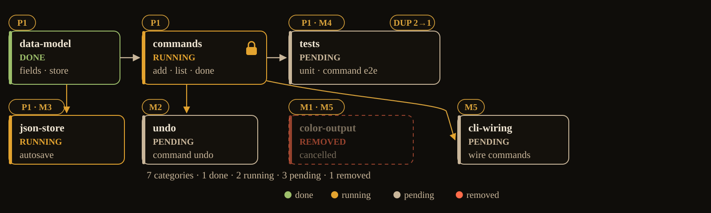
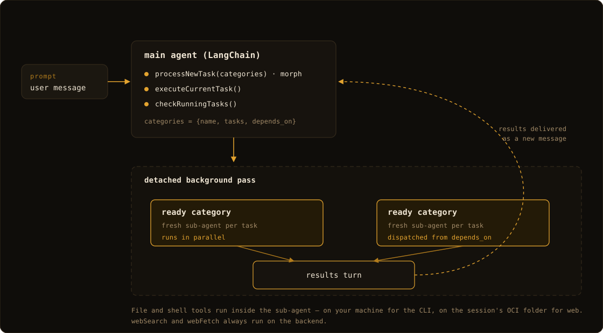
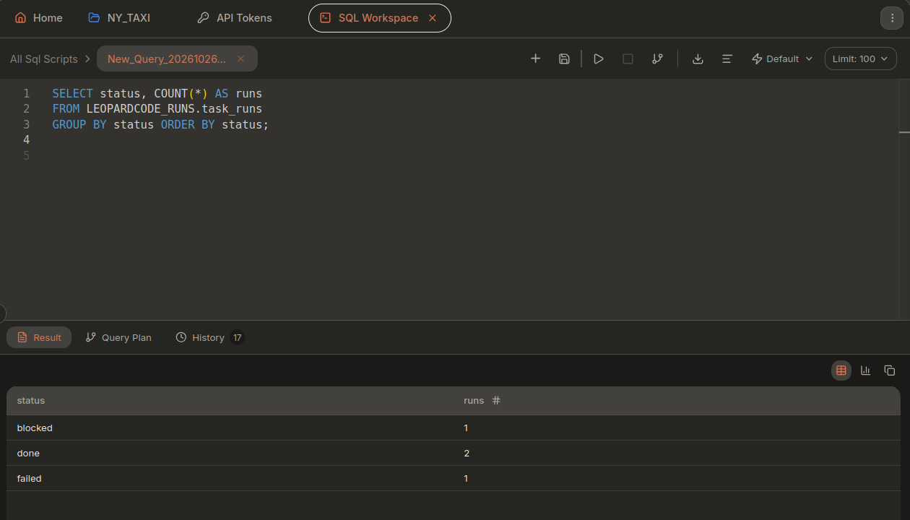

# leopardcode

**Real-time task morphing for your coding agents.**

Morph the plan while it runs. leopardcode keeps one persistent plan and edits it
in place as you prompt: add, remove, rename/rescope, dedupe, and rewire pending
work while running categories keep going. No restarts. No lost progress.

Most agents run a task list. leopardcode morphs a graph that is still running.

[](https://github.com/includecctype/leopardcode-open-agent-hackathon-2026/actions/workflows/ci.yml)
[](https://github.com/includecctype/leopardcode-open-agent-hackathon-2026/actions/workflows/sponsor-smoke.yml)
[](https://github.com/includecctype/leopardcode-open-agent-hackathon-2026/actions/workflows/meterless-conformance.yml)
· **Sponsor stack:** [NVIDIA Nemotron](#sponsor-technology) (models 2–4) · [Meterless](#sponsor-technology) H-MEM · [Zetaris](#sponsor-technology) FILESTORE
· [Website](https://includecctype.github.io/leopardcode-open-agent-hackathon-2026/)
· [Live web demo](https://includecctype.github.io/leopardcode-open-agent-hackathon-2026/demo/)
· [Documentation](docs/README.md)


> **Try it in 30 seconds.** Open the [live web demo](https://includecctype.github.io/leopardcode-open-agent-hackathon-2026/demo/),
> pick **model 2 (Nemotron)** and paste your own `nvapi-...` NVIDIA API key when
> prompted, then type **`/sample`**. Each scenario seeds a task graph, then sends
> five follow-up prompts that **morph the plan live** — work already running is
> never interrupted. Model 6 (DeepSeek Flash) remains the no-key, operator-funded
> fallback.

## The problem: plans freeze when work starts

Today's coding agents treat every prompt as a fresh start:

- **Plans freeze.** Once work is running, changing course means restarting the
  prompt — throwing away everything already in flight.
- **No live morph.** A new requirement cannot reshape pending work while agents
  are executing; the user has to stop, re-plan, and re-explain.
- **Every prompt re-plans from scratch.** Overlapping work gets redone and intent
  from earlier prompts is forgotten.
- **Parallel work has no structure.** Whether tasks depend on each other, overlap,
  or could run together lives only in the model's prose, and vanishes the moment
  the request ends.

The missing capability is **real-time task morphing**: reshaping the pending plan
while execution continues, with running work untouched.

## Because the plan morphs, you can…

- **Change the spec mid-run.** Send the change; pending categories are rewritten
  in place. Running work keeps going.
- **Add work you just discovered.** A migration, tests, docs, or rate limiting
  enters pending work and runs when its dependencies finish.
- **Drop or rename pending work.** Stop spend before a task starts, or rescope it
  as your understanding improves.
- **Repeat a request without duplicate work.** Overlapping task lines fold into the
  existing category; you do not pay for the same pending task twice.
- **Rewire dependencies and reprioritize.** Add a `depends_on` edge and the next
  ready category dispatches — no restart.

> Work already running stays untouched. You can drop pending work; you cannot
> cancel a running category.

The full user workflows are in [what you can do](docs/product/user_workflows.md).

## What leopardcode does

- **Real-time task morphing.** A new prompt reshapes pending work in place — add,
  remove, rename/rescope, dedupe, rewire — while running work continues.
- **One living plan.** A persistent task graph per session: the substrate every
  morph edits.
- **Work as a graph, not a list.** First-class relationships: `depends_on`
  ordering, duplicate removal, and each category's results flowing into its
  dependents.
- **Dependency-aware parallelism.** Categories launch the moment their
  dependencies finish, and a failure cascades `blocked` to everything downstream.
- **In-flight protection.** Running work is immutable, so "keep sending prompts"
  can never race an executor mid-change.
- **Memory that compounds.** H-MEM (the Meterless engine) keeps durable
  preferences per project and recalls them into later plans; `/memory` shows
  what it knows.
- **Your code stays yours.** In the CLI, file and shell tools run on your machine;
  the server only makes model calls and optional web searches.

## See it: five live morphs



A seed prompt starts the CLI todo plan. Five follow-ups add independent work, add a
dependency, rename a pending category, dedupe a repeated test request, and drop a
pending task. The running command card never changes; when the plan drains,
leopardcode reports what finished as its own message.

Watch it live: the web workspace ships ten scripted scenarios behind the **`/sample`** command.

## Why it's different

| | Typical coding agents | leopardcode |
|---|---|---|
| **Live morph while running** | no — restart the prompt | **yes — pending work only** |
| **Across prompts** | re-plans from scratch | **morphs pending work live** |
| **Work relationships** | implicit in the model's prose | **first-class**: `depends_on`, dedupe, result flow |
| **Parallelism** | decided ad hoc | dispatched from explicit dependency readiness |
| **Where code runs** (CLI) | a vendor server | on your machine |

## How it works



*The main agent morphs the pending graph; each ready category runs a fresh sub-agent in parallel; results come back as a new message.*

- One prompt worker per session turns prompts into planning turns, so turns never
  overlap.
- `processNewTask` morphs the pending graph: validate, repair, DAG-check, merge,
  cascade, commit.
- Only `pending_categories` is ever replaced — `running_categories` is untouched by
  design.
- Execution runs in a **detached background pass**; a planning gate keeps it from
  exiting while a later prompt is still morphing, and morphs that are ready join
  the pass.

Full detail: [real-time task morphing](docs/engineering/task_morphing.md) ·
[architecture](docs/engineering/architecture.md) ·
[pipelines](docs/engineering/pipelines.md).

## Sponsor technology

leopardcode targets the hackathon sponsor stack; the integrations ship in the
product and, for the hosted services, in guarded CI smoke jobs:

| Sponsor | Where it lives | Proof |
|---|---|---|
| **NVIDIA Nemotron** | Models 2–4 (`model/model_client.py`) run on Nemotron through NIM, keyed by the user's own NVIDIA API key | The model that plans each live morph; every planning and execution turn on models 2–4 runs on the selected Nemotron model |
| **Meterless** | `packages/hmem/src/` — our H-MEM engine, wired as per-project CLI memory (durable preferences, plan completions, `/memory`) | H-MEM recalls durable preferences into the next morph; `H-MEM Conformance` passes the pinned suite (13/13, output archived at `docs/media/hmem-conformance.txt`) |
| **Zetaris** | `backend/sponsor/zetaris_client.py` — documented REST queries (`/sql-editor/sqls/run` with Bearer key, `X-Org-ID`, and `X-Request-ID`); `zetarisQuery` gives sub-agents read-only SQL during tasks; the CLI's `user_config/task_runs.csv` is exposed as a Zetaris FILESTORE table | Records the task runs behind each morph; `Zetaris REST Smoke` runs the committed `task_runs` analytics query through the REST API, falling back to `SELECT 1` when the table is not yet registered; the table and analytics query were verified against a local instance |



*The Zetaris SQL Workspace answering the committed `task_runs` query. The CLI
writes every finished category to `user_config/task_runs.csv`; the bundle
exposes that file as the `LEOPARDCODE_RUNS.task_runs` FILESTORE table; this query
returns the run counts by status (`blocked 1 · done 2 · failed 1`), and
`zetarisQuery` lets sub-agents ask the same table read-only mid-task.*

Zetaris values stay environment-only: names are documented in `.env.example`,
the smoke job reports a skip until its secret exists, and the same check runs
locally with `python -m sponsor.smoke zetaris`.

## Try it

**Web workspace (live demo):**
<https://includecctype.github.io/leopardcode-open-agent-hackathon-2026/demo/> — the same Ink
terminal plus an OCI-backed file explorer and viewer. Type **`/sample`** to run one of
ten scripted scenarios that build a task graph and morph it live.

**Backend** (Python 3.13 + [uv](https://docs.astral.sh/uv/)):

```bash
cd backend
uv sync --all-extras
uv run main.py                     # → Uvicorn on 0.0.0.0:8000
```

**CLI** (Node 22) — run the published package, or from source with pnpm:

```bash
npx leopardcode                    # reference deployment (baked at publish)

cd terminal && pnpm install       # from source
LEOPARDCODE_BACKEND_URL=http://localhost:8000 pnpm dev
```

**Web workspace**, or everything at once with the `justfile`:

```bash
cd web && pnpm install && LEOPARDCODE_BACKEND_URL=http://localhost:8000 pnpm dev
just backend   # gateway on :8000
just terminal  # CLI
just web       # browser workspace
```

Models are selected by id and served through the NVIDIA NIM endpoint: 2 is
Nemotron 3.5 Super 120B, 3 is Nemotron 3.5 Lightning 30B, and 4 is Nemotron 3
Ultra 550B. Pick a model and paste your own NVIDIA API key (`nvapi-…` from
build.nvidia.com) — the CLI asks on `/model` or `/key`, the web workspace asks on
selection. Your key stays in the client's local config and is sent to your
backend for the session; the backend holds no NVIDIA credential of its own. The
web workspace also offers model 6 (DeepSeek Flash), funded by the operator via
`PROVIDED_MODEL_KEY` and refused for non-web clients, so the demo runs without a
key. In the CLI, `/memory` shows the project memories H-MEM has stored and
`/runs` lists the task-run rows recorded in `user_config/task_runs.csv`. Keyboard
shortcuts are below.

Setup details — environment variables, OCI storage, rate limits, and checks —
live in [build_and_run](docs/engineering/build_and_run.md).

## Keyboard shortcuts

The CLI and the web workspace share the same command set and editing keys; the
CLI adds the Tasks-pane scroll.

| Key | Action |
|---|---|
| `Enter` | Send the prompt |
| `Shift+Enter` | New line in the draft |
| `Tab` | Complete the highlighted `/command` |
| `↑` / `↓` | Pick a suggestion; move within a multi-line draft; otherwise scroll the chat one line |
| `←` / `→` | Move the cursor |
| `PageUp` / `PageDown` | Scroll the chat one screen |
| `Home` / `End` | Jump the chat to the top / bottom |
| `Ctrl+↑` / `Ctrl+↓` | Scroll the Tasks pane (CLI only — the web has a task-graph pane) |
| `Esc` | Close the command overlay, leave the questionnaire write-in box, cancel a running `/sample` (web), or close the file viewer |
| Mouse wheel | Scroll the chat; over the Tasks pane in the CLI |

Pasting multi-line text inserts it without submitting. Full input notes live in
[terminal reference](docs/engineering/terminal_reference.md#keybindings--input).

## Built with opencode

The agent configuration is committed so the setup is reproducible:

| Artifact | Purpose |
|---|---|
| `AGENTS.md` | Working agreement: plan first, ask before assuming, follow the rules. Agent configuration lives in the development workspace; this repository keeps a neutral working agreement. |

### One worktree per concern

Every change lives in its own **git worktree** under `LEOPARDCODE/`, named
`leopardcode-<PURPOSE>` beside `leopardcode-MAIN` — one concern per worktree,
small scoped commits, one pull request per concern. `main` never holds
unreviewed work. Merged PRs to date: #52–#60.

### MCP tooling for everything that is not code

Three MCP servers cover planning, documentation, design, and the presentation:

- **Obsidian — planning and documentation.** A project vault kept in sync as the
  code changes.
- **Penpot — design.** Concept and architecture visuals, web-workspace layout.
- **LibreOffice — the submission deck.** Slides and PDF drafted from the product
  notes.

## Business value

leopardcode is a **coordination layer**, not another executor — the memory,
scheduling, and interaction shell around agents you already run.

- **Cost avoidance.** Morphing stops duplicate and re-planned work from burning
  tokens and wall-clock; pending work can be dropped before it starts.
- **Security.** In the CLI, code and secrets never leave the developer's machine;
  the server is a thin Socket.IO + model orchestrator with no database.
- **Responsiveness.** Teams morph a running plan instead of restarting, which
  shortens the gap between intent and working code.

### How it compares

Request-scoped agents (Claude Code, OpenAI Codex, Cursor, Aider, OpenHands) are
strong executors, but every prompt starts a fresh plan. leopardcode keeps the plan:

| Buyer question | Request-scoped agents | leopardcode |
|---|---|---|
| Live morph while running | no — restart the prompt | yes — pending work only |
| Cost of changing your mind | restart, lose in-flight work | pending work morphs; running work untouched |
| Parallelism risk | dependencies improvised by the model | dispatched from explicit dependency readiness |
| Where code lives (CLI) | per-tool (vendor or local) | on your machine; the server is a thin orchestrator |

The full cases are in [business_value](docs/product/business_value.md) and
[competition_analysis](docs/product/competition_analysis.md).

## Repository map

| Path | What it is |
|---|---|
| `backend/` | Python 3.13 Socket.IO gateway: LangChain/LangGraph agents, DAG scheduler, OCI storage |
| `terminal/` | Node 22 + pnpm CLI (Ink/React) — the two-pane TUI |
| `web/` | Vite + React browser workspace: Ink via ink-web, plus an OCI file explorer and viewer |
| `docs/` | Engineering, product, and hackathon reference documentation |
| `docker-compose.yml`, `justfile` | Backend hosting and dev shortcuts |

## Learn more

- [Problem](docs/product/problem.md) · [Solution](docs/product/solution.md) ·
  [What you can do](docs/product/user_workflows.md) ·
  [Competition analysis](docs/product/competition_analysis.md)
- [Real-time task morphing](docs/engineering/task_morphing.md) ·
  [Architecture](docs/engineering/architecture.md) ·
  [Pipelines](docs/engineering/pipelines.md) ·
  [Socket protocol](docs/engineering/socket_protocol.md) ·
  [AI tools](docs/engineering/ai_tools.md)
- [Build & run](docs/engineering/build_and_run.md) ·
  [Sponsor verification](docs/engineering/sponsor_verification.md) ·
  [Full documentation index](docs/README.md)
- [Open Agent Hackathon 2026](docs/hackathon/overview.md) ·
  [Submission checklist](docs/product/submission.md)
