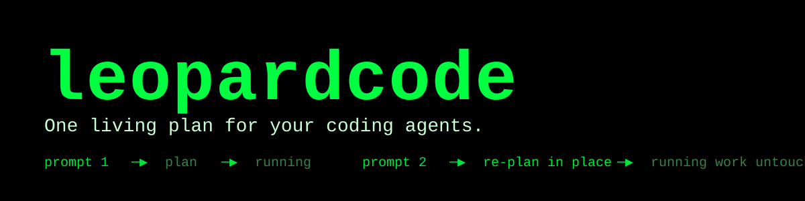

# leopardcode

**One living plan for your coding agents.**

leopardcode keeps multi-agent coding work in a **single, persistent task graph**.
Keep sending prompts: each one **incrementally re-plans** the work that's still
ahead, while work already running keeps running — no restarts, no lost progress.

Most agents run a task list. leopardcode runs a graph that remembers.

[](https://github.com/includecctype/leopardcode-open-agent-hackathon-2026/actions/workflows/ci.yml)
[](https://github.com/includecctype/leopardcode-open-agent-hackathon-2026/actions/workflows/sponsor-smoke.yml)
· [Website](https://includecctype.github.io/leopardcode-open-agent-hackathon-2026/)
· [Live web demo](https://includecctype.github.io/leopardcode-open-agent-hackathon-2026/demo/)
· [Documentation](docs/README.md)



> **Try it in 30 seconds.** Open the [live web demo](https://includecctype.github.io/leopardcode-open-agent-hackathon-2026/demo/),
> pick the provided model (6), and type **`/sample`**. Each scenario seeds a task graph, then
> sends five follow-up prompts that **incrementally re-plan** it — work already running is never
> interrupted.

## The problem: agents forget, and restarts waste work

Today's coding agents treat every prompt as a fresh start:

- **Restarts lose work.** Change your mind mid-run and you're told to restart the
  prompt — throwing away everything already in flight.
- **Every prompt re-plans from scratch.** Overlapping work gets redone and intent
  from earlier prompts is forgotten.
- **Parallel work has no structure.** Whether tasks depend on each other, overlap,
  or could run together lives only in the model's prose, and vanishes the moment
  the request ends.

## What leopardcode does

- **One living plan.** A persistent task graph that survives across prompts and
  sessions.
- **Incremental re-planning.** A new prompt reshapes the work that's still ahead;
  work already running is never disturbed.
- **Work as a graph, not a list.** First-class relationships: `depends_on`
  ordering, duplicate removal, and each category's results flowing into its
  dependents.
- **Dependency-aware parallelism.** Categories launch the moment their
  dependencies finish, and a failure cascades `blocked` to everything downstream.
- **In-flight protection.** Running work is immutable, so "keep sending prompts"
  can never race an executor mid-change.
- **Memory that compounds.** H-MEM (the Meterless engine) keeps durable
  preferences per project and recalls them into later plans; `/memory` shows
  what it knows.
- **Your code stays yours.** In the CLI, file and shell tools run on your machine;
  the server only makes model calls and optional web searches.

## See it: one plan, three prompts

```
prompt 1 · "fix the login bug"
        │
        ▼
   ┌──────────────────────┐
   │ login-fix       ▶ running │
   └──────────────────────┘
        │
prompt 2 · "also harden session handling"      (sent while login-fix is running)
        │
        ▼
   ┌──────────────────────┐   ┌──────────────────────┐
   │ login-fix       ▶ running │   │ session-hardening  pending │   ← added to the plan
   └──────────────────────┘   └──────────────────────┘
        │
prompt 3 · "actually, drop the session work"   (sent while login-fix is running)
        │
        ▼
   ┌──────────────────────┐        session-hardening removed from pending work;
   │ login-fix       ▶ running │   login-fix was never interrupted
   └──────────────────────┘
```

Each prompt is planned immediately and folded into the same running plan. When the
plan drains, leopardcode reports what finished — as its own message.

Watch it live: the web workspace ships ten scripted scenarios behind the **`/sample`** command.

## Why it's different

| | Typical coding agents | leopardcode |
|---|---|---|
| **Unit of work** | one prompt / one spawned agent | an entry in a persistent work graph |
| **Across prompts** | re-plans from scratch | **incremental re-planning** on one living plan |
| **Work relationships** | implicit in the model's prose | **first-class**: `depends_on`, dedupe, result flow |
| **Parallelism** | decided ad hoc | dispatched from explicit dependency readiness |
| **Changing course** | start the prompt over | keep going; only pending work changes |
| **Where code runs** (CLI) | a vendor server | on your machine |

## How it works

```
prompt ─▶ main agent (LangChain)
            ├─ processNewTask(categories)     categories = {name, tasks, depends_on}
            └─ executeCurrentTask()           starts or joins the background pass
                     │
        ┌────────────┴────────────┐
        ▼                         ▼
  ready category            ready category          ← run in parallel
  (a fresh sub-agent per task) (a fresh sub-agent per task)
        │                         │
        └───────── results ───────┘
                     ▼
              results turn ─▶ main agent reports back
```

- One prompt worker per session turns prompts into planning turns, so turns never
  overlap.
- Execution runs in a **detached background pass**; a planning gate keeps it from
  exiting while a later prompt is still re-planning.
- Only `pending_categories` is ever replaced — `running_categories` is untouched by
  design.

Full detail: [architecture](docs/engineering/architecture.md) ·
[pipelines](docs/engineering/pipelines.md).

## Sponsor technology

leopardcode targets the hackathon sponsor stack; each integration ships as a
backend client with a guarded CI smoke job:

| Sponsor | Where it lives | Proof |
|---|---|---|
| **NVIDIA Nemotron** | Models 2–4 (`model/model_client.py`) run on Nemotron through NIM; `backend/sponsor/nim_client.py` covers the same endpoint with authenticated model listing plus chat completions | `Nemotron NIM Smoke` picks a Nemotron model and completes a live prompt through NIM |
| **Meterless** | `terminal/src/memory/` — our H-MEM engine, wired as per-project CLI memory; `backend/sponsor/meterless_client.py` — the runtime contract: status from `GET /v1/models`, `meterless-app`/`meterless-scope` headers, `meterless/*` routing modes | `H-MEM Conformance` runs our engine against the pinned suite (13/13), and `Meterless Hotspot Smoke` runs a chat through a local runtime |
| **Zetaris** | `backend/sponsor/zetaris_client.py` — documented REST queries (`/sql-editor/sqls/run` with Bearer key, `X-Org-ID`, and `X-Request-ID`) | `Zetaris REST Smoke` runs the committed verification query (`backend/sponsor/sql/zetaris_verification_select.sql`) through the REST API |

Configuration is environment-only: variable names are documented in
`.env.example`, values live in the local environment or GitHub Actions
secrets, and each smoke job reports a skip until its secret exists. The same
checks run locally with `python -m sponsor.smoke <nemotron|meterless|zetaris>`.

## Try it

**Web workspace (live demo):**
<https://includecctype.github.io/leopardcode-open-agent-hackathon-2026/demo/> — the same Ink
terminal plus an OCI-backed file explorer and viewer. Type **`/sample`** to run one of
ten scripted scenarios that build a task graph and incrementally re-plan it.

**Backend** (Python 3.13 + [uv](https://docs.astral.sh/uv/)):

```bash
cd backend
uv sync --all-extras
uv run main.py                     # → Uvicorn on 0.0.0.0:8000
```

**CLI** (Node 22) — run the published package, or from source with pnpm:

```bash
npx leopardcode                    # reference deployment (baked at publish)

cd terminal && pnpm install       # from source
LEOPARDCODE_BACKEND_URL=http://localhost:8000 pnpm dev
```

**Web workspace**, or everything at once with the `justfile`:

```bash
cd web && pnpm install && LEOPARDCODE_BACKEND_URL=http://localhost:8000 pnpm dev
just backend   # gateway on :8000
just terminal  # CLI
just web       # browser workspace
```

Models are selected by id and served through the NVIDIA NIM endpoint: 2 is
Nemotron 3.5 Super 120B, 3 is Nemotron 3.5 Lightning 30B, and 4 is Nemotron 3
Ultra 550B. The web workspace also offers model 6 (DeepSeek Flash), funded by the
operator via `PROVIDED_MODEL_KEY` and refused for non-web clients. Every model
reads its credential from the server environment (`NVIDIA_API_KEY` for Nemotron),
so clients never handle a provider key. In the CLI, `/memory` shows the project
memories H-MEM has stored, `↑`/`↓` and `PageUp`/`PageDown` scroll the chat,
`Ctrl+↑`/`Ctrl+↓` scroll the Tasks pane, and `Esc` clears the prompt.

Setup details — environment variables, OCI storage, rate limits, and checks —
live in [build_and_run](docs/engineering/build_and_run.md).

## Built with opencode

The agent configuration is committed so the setup is reproducible:

| Artifact | Purpose |
|---|---|
| `AGENTS.md` | Working agreement: plan first, ask before assuming, follow the rules. |
| `.opencode/opencode.json` | MCP servers: Obsidian, Penpot, and LibreOffice. |
| `.opencode/rules/*` | The structure, variable, project-layout, Obsidian, and LibreOffice rules the agent follows. |

### One worktree per concern

Every change lives in its own **git worktree** under `LEOPARDCODE/`, named
`leopardcode-<PURPOSE>` beside `leopardcode-MAIN` — one concern per worktree,
small scoped commits, one pull request per concern. `main` never holds
unreviewed work. *(TODO: record the concern/PR count as changes land.)*

### MCP tooling for everything that is not code

Three MCP servers cover planning, documentation, design, and the presentation:

- **Obsidian — planning and documentation.** A project vault kept in sync as the
  code changes.
- **Penpot — design.** Concept and architecture visuals, web-workspace layout.
- **LibreOffice — the submission deck.** Slides and PDF drafted from the product
  notes.

## Business value

leopardcode is a **coordination layer**, not another executor — the memory,
scheduling, and interaction shell around agents you already run.

- **Cost avoidance.** One living plan stops duplicate and re-planned work from
  burning tokens and wall-clock.
- **Security.** In the CLI, code and secrets never leave the developer's machine;
  the server is a thin Socket.IO + model orchestrator with no database.
- **Responsiveness.** Teams keep re-steering instead of restarting, which shortens
  the gap between intent and working code.

### How it compares

Request-scoped agents (Claude Code, OpenAI Codex, Cursor, Aider, OpenHands) are
strong executors, but every prompt starts a fresh plan. leopardcode keeps the plan:

| Buyer question | Request-scoped agents | leopardcode |
|---|---|---|
| Re-planning / re-explaining | every prompt re-plans | one living plan; work is deduped |
| Cost of changing your mind | restart, lose in-flight work | pending work re-planned; running work untouched |
| Parallelism risk | dependencies improvised by the model | dispatched from explicit dependency readiness |
| Where code lives (CLI) | per-tool (vendor or local) | on your machine; the server is a thin orchestrator |

The full cases are in [business_value](docs/product/business_value.md) and
[competition_analysis](docs/product/competition_analysis.md).

## Repository map

| Path | What it is |
|---|---|
| `backend/` | Python 3.13 Socket.IO gateway: LangChain/LangGraph agents, DAG scheduler, OCI storage |
| `terminal/` | Node 22 + pnpm CLI (Ink/React) — the two-pane TUI |
| `web/` | Vite + React browser workspace: Ink via ink-web, plus an OCI file explorer and viewer |
| `docs/` | Engineering, product, and hackathon reference documentation |
| `docker-compose.yml`, `justfile` | Backend hosting and dev shortcuts |

## Learn more

- [Problem](docs/product/problem.md) · [Solution](docs/product/solution.md) ·
  [Competition analysis](docs/product/competition_analysis.md)
- [Architecture](docs/engineering/architecture.md) ·
  [Pipelines](docs/engineering/pipelines.md) ·
  [Socket protocol](docs/engineering/socket_protocol.md) ·
  [AI tools](docs/engineering/ai_tools.md)
- [Build & run](docs/engineering/build_and_run.md) ·
  [Sponsor verification](docs/engineering/sponsor_verification.md) ·
  [Full documentation index](docs/README.md)
- [Open Agent Hackathon 2026](docs/hackathon/overview.md) ·
  [Submission checklist](docs/product/submission.md)
